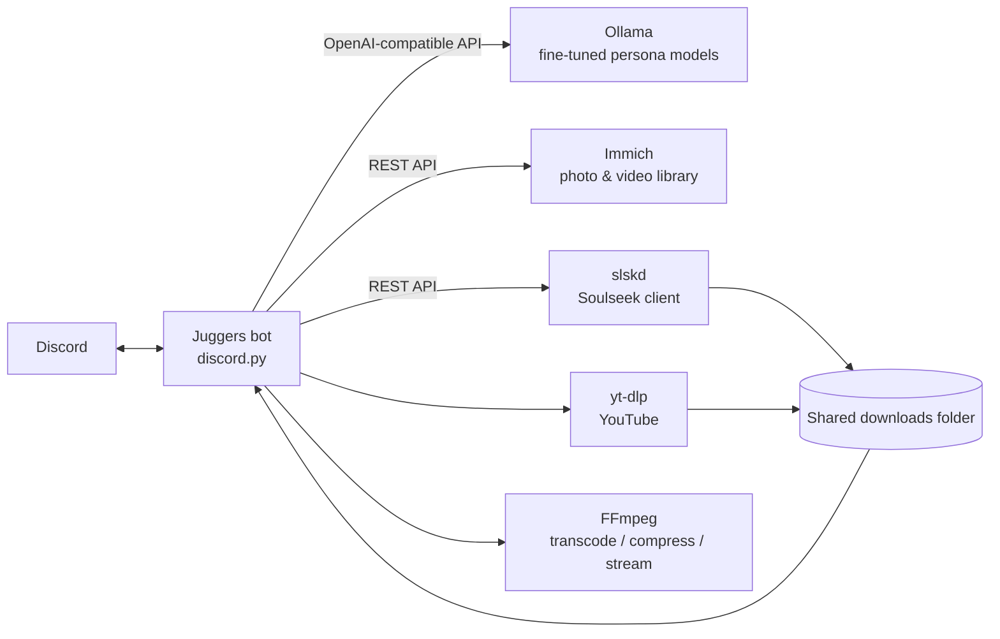

# Juggers

A self-hosted Discord bot I built for my friends' server. It started as a way to search our shared photo library from Discord, then grew a music player, a YouTube downloader, and a set of local LLMs I fine-tuned on our own chat history so the bot can talk like (some of) us.

Nothing goes to a cloud API. The bot runs on a small Ubuntu box at home (an Intel i3-10100 with integrated graphics, no dedicated GPU) and connects to services I already self-host in Docker: **Ollama** for the language models, **Immich** for photos and videos, and **slskd** for Soulseek.

> This is a personal project, not a polished product. It works well for one server on one machine. If you want to run it yourself, expect to spend a bit of time getting the paths and API keys right.

<!-- Add a screenshot or GIF here once you've got one, e.g.  -->

---

## What it does

**Chat with local LLMs**
- `!llm start` turns a channel into chat mode. The bot replies to normal messages, with no prefix needed.
- Switch between personas on the fly. When you switch, the old model is unloaded from RAM, which matters when everything runs on a CPU.
- The persona models are fine-tuned with [Unsloth](https://github.com/unslothai/unsloth) on exported messages from our server, then served through Ollama.
- There's a small "chaos" chance where the bot gets an unhinged instruction instead of its normal persona. You can switch it off.

**Music, from Soulseek or YouTube**
- `!music <song>` searches Soulseek through slskd. It filters out remixes, live versions and karaoke you didn't ask for, then ranks results by bitrate, track length and how fast or busy each peer is.
- Up to 10 options appear in an embed, and anyone can pick one by reacting with a number. If one peer stalls, the bot moves on to the next.
- Tracks come back as a **Discord voice message** (with a proper waveform). With `!music play`, the bot joins your voice channel instead.
- Voice playback has a queue, skip, loop, now-playing, and live **0.1x–10x speed changes** that keep the pitch, applied mid-song.
- `!ytmusic` does the same thing with YouTube as the source.
- Downloads are cached, so a second request for the same song is instant.

**YouTube videos**
- `!yt <query or link>` downloads the video. If it's over Discord's 20MB upload limit, the bot works out the right bitrate and re-encodes it with FFmpeg to fit, showing live progress as it goes.

**Photo and video search (Immich)**
- Search the Immich library by meaning (Immich's CLIP smart search), by text inside the image (OCR), by filename, or by description. The top match gets posted straight into the channel.

**Server stats**
- `!taskmanager` shows a live embed with CPU and iGPU usage, clocks, temperatures, power draw (read from Intel RAPL) and RAM. Download progress bars show the same stats, so you can watch the poor i3 struggle in real time.

---

## How it fits together



The bot and slskd both read and write the same downloads folder. slskd saves the files, and the bot picks them up and transcodes them. This shared folder is the part most likely to break during setup (see [Gotchas](#gotchas)).

---

## Requirements

| Service | What it's used for | Required? |
|---|---|---|
| [Ollama](https://ollama.com) | Runs the chat models | For `!llm` |
| [Immich](https://immich.app) | Photo/video search | For `!search`, `!ocr`, `!filename`, `!desc` |
| [slskd](https://github.com/slskd/slskd) | Soulseek searches and downloads | For `!music` |
| FFmpeg | All audio/video processing | Yes (included in the Docker image) |
| A Discord bot token | ...it's a Discord bot | Yes |

In the developer portal, turn on the **Message Content** intent for the bot. The bot also needs permission to add reactions and manage messages (manage messages is used to clear the picker reactions), plus connect/speak for voice.

You don't need all of these. If a service isn't running, its commands will just return an error and the rest of the bot keeps working.

---

## Setup

### 1. Clone and configure

```bash
git clone https://github.com/Zidane404/juggers-bot.git
cd juggers-bot
cp .env.example .env
cp personas.example.json personas.json
```

Fill in `.env` with your Discord token, the Immich and slskd API keys, and the path to slskd's downloads folder. Then edit `personas.json` to point at whatever models you have in Ollama.

### 2a. Run with Docker (what I do)

```bash
docker compose up -d --build
docker compose logs -f juggers
```

The compose file uses host networking, so `localhost` in the URLs reaches the other containers through their published ports. If your services share a Docker network, remove `network_mode: host` and use container names in the URLs instead.

### 2b. Or run it directly

```bash
python3 -m venv .venv && source .venv/bin/activate
pip install -r requirements.txt
sudo apt install ffmpeg
python bot.py
```

---

## Personas and fine-tuning

The models are configured in `personas.json`, which isn't committed (it names real people from the server):

```json
{
  "models": {
    "default": { "model_name": "some-base-model", "prompt": "You are called juggers..." },
    "friend-a": { "model_name": "friend-a-model", "prompt": "You are friend-a chatting with your friends..." }
  },
  "stop_prefixes": ["juggers:", "friend-a:"]
}
```

Here's roughly how I build a persona:

<!-- Tweak these steps to match exactly what you did -->

1. Export the server's message history and filter it down to one person's messages, keeping a few earlier messages from the conversation as context for each one.
2. Fine-tune a small instruct model on that data with Unsloth.
3. Export it to GGUF and import it into Ollama with a `Modelfile`, under the name used in `personas.json`.

Some things I picked up along the way:
- Small models trained on chat logs love to continue the chat log, writing the next five messages as other people. The bot works around this in three ways: it formats speakers as `<Name>`, passes `\n<` as a stop token, and cuts replies at any name in `stop_prefixes`.
- A short rolling history (the system prompt plus the last four messages) works better than a long one on a 3B-class model, and it keeps responses fast on a CPU.
- `!llm addmodel` registers a model until the next restart. To keep it, add it to `personas.json`.

**The training data and model weights are not in this repo** and never will be, because they're made from private messages. If you build your own, make sure the people whose messages you use are okay with it.

---

## Commands

| Command | What it does |
|---|---|
| `!help` | Command list |
| `!ping` | Latency check |
| `!taskmanager` | Live hardware monitor (20 updates) |
| `!search <image\|gif\|video> <query>` | Immich smart (CLIP) search |
| `!ocr <type> <query>` | Search by text inside media |
| `!filename <type> <query>` | Search by filename |
| `!desc <type> <query>` | Search by description |
| `!llm start` / `!llm stop` | Turn chat mode on or off in this channel |
| `!llm purge` | Wipe the conversation memory |
| `!llm models` | List personas |
| `!llm switch <name>` | Change persona and unload the old model |
| `!llm addmodel <name> <ollama-model> <prompt>` | Add a persona until restart |
| `!music <song>` | Soulseek → voice message |
| `!music play <song>` | Soulseek → voice channel (or queue) |
| `!ytmusic <song or link>` | YouTube → voice message |
| `!ytmusic play <song or link>` | YouTube → voice channel |
| `!yt <video or link>` | Download, compress to under 20MB and upload |
| `!music np` / `!music q` | Now playing / queue |
| `!music skip` / `!music stop` | Skip the track / stop and leave |
| `!music loop <n>` | Repeat the current track n more times |
| `!playback speed <0.1-10>` | Change speed live, keeping the pitch |
| `!cache purge` | Delete all downloaded media and reset the cache |

Tip: `!music Artist - Title` gives much better Soulseek matches than a loose search.

---

## Configuration

All settings come from environment variables, which `.env` sets for you:

| Variable | Default | Notes |
|---|---|---|
| `DISCORD_BOT_TOKEN` | – | Required |
| `OLLAMA_URL` | `http://localhost:11434/v1` | Ollama's OpenAI-compatible endpoint |
| `PERSONAS_FILE` | `personas.json` | Falls back to a single default persona if missing |
| `DEFAULT_PERSONA` | `default` | Which persona is active on startup |
| `IMMICH_URL` / `IMMICH_API_KEY` | `http://localhost:2283` / – | |
| `SLSKD_URL` / `SLSKD_API_KEY` | `http://localhost:5030` / – | |
| `SLSKD_DOWNLOADS_LOCAL` | `./downloads` | Host path of slskd's downloads folder |
| `MUSIC_CACHE_FILE` | `music_cache.json` | Remembers downloaded tracks |
| `MUSIC_TEMP_DIR` | `music_tmp` | Scratch space for transcodes |

Some smaller settings (search timeout, how many options the picker shows, the speed range, the chaos chance and prompts) are constants near the top of `bot.py`.

---

## Gotchas

- **"Downloaded, but the bot can't see the file."** `SLSKD_DOWNLOADS_LOCAL` has to be the folder slskd actually writes to, from the bot's point of view. In Docker, mount it at the same path inside and outside the container (the compose file already does this).
- **Power readings say N/A.** Since a 2020 kernel change, Intel RAPL energy counters can only be read as root. Run the bot as root inside the container, or skip the power readings.
- **Uploads fail on big files.** Videos are compressed to fit 20MB. Voice messages also respect the server's own upload limit. Long videos can't always be compressed below that and still look acceptable, so the bot refuses instead of uploading something unwatchable.
- **The MusicBrainz lookup is commented out.** Right now the bot sends your query to Soulseek as-is. The lookup code is still in `resolve_track` if you want to bring it back.
- **Personas added with `!llm addmodel` disappear on restart.** That's on purpose. Put permanent ones in `personas.json`.

---

## Things I'd like to do next

- Split `bot.py` into cogs (LLM, music, Immich, utilities) now that it's over 2,000 lines
- Move to slash commands
- Save chat mode and queue state across restarts
- Add tests for the Soulseek scoring logic

---

## A note on use

This is built for a private server of friends. Only download things you have the right to, follow the terms of the services you connect it to, and don't train models on people's messages without asking them first.

## License

MIT. See [LICENSE](LICENSE).
